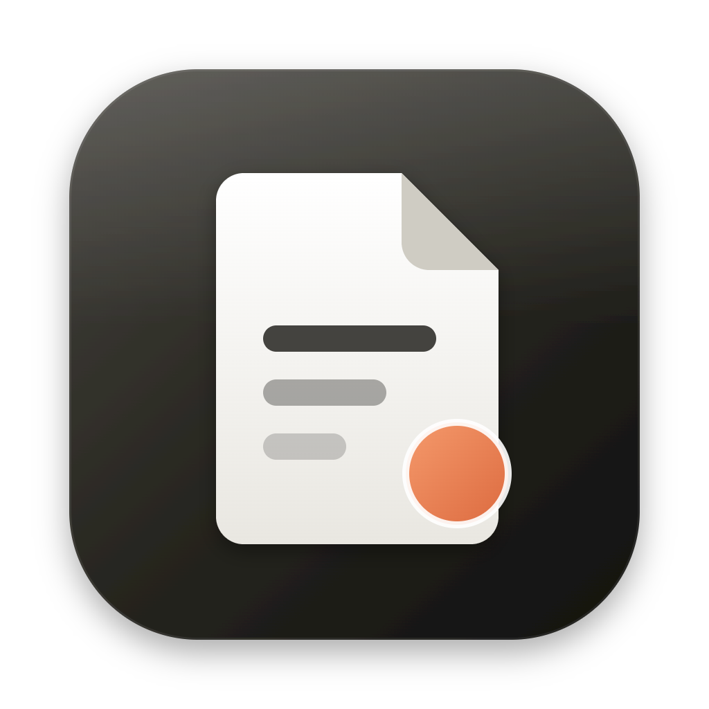
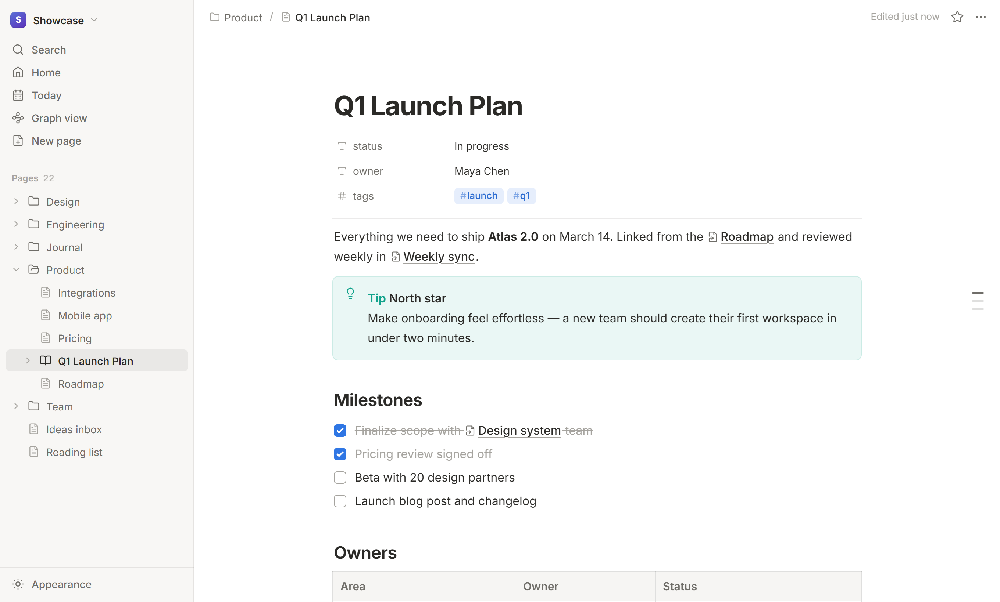

<p align="center"></p>
<h1 align="center">Local Notes</h1>
<p align="center">A calm, Notion-style editor for plain markdown files — with wikilinks, backlinks, a graph view and templates.<br>Works with your Obsidian vault. Free for Windows, macOS and Linux.</p>



## Download

Get the latest installer from **[Releases](https://github.com/harshid-lgtm/local-notes/releases/latest)**:

| Platform | File |
| --- | --- |
| Windows 10/11 | `Local-Notes-Setup-<version>-x64.exe` (or `-arm64.exe`) |
| macOS 11+ | `Local-Notes-<version>-mac.dmg` (Apple Silicon + Intel) |
| Linux | `.AppImage` (any distro) or `.deb` (Ubuntu/Debian) |

Installed apps update themselves when a new release is published.

> Early builds aren't code-signed. On Windows choose **More info → Run anyway**; on macOS right-click the app and choose **Open** the first time.

## Features

- **Invisible markdown** — headings, checklists, tables, callouts, code and images render as you type. Files stay clean markdown.
- **Slash commands, drag handles and a formatting toolbar**, Notion-style.
- **Wikilinks & backlinks** — type `[[` to link; every page lists what links to it, plus unlinked mentions.
- **Graph view** — an interactive map of your vault, coloured by folder, with a local graph per page.
- **Wiki structure** — nest pages inside pages (stored as `Page.md` + `Page/`), breadcrumbs, subpage lists and a floating outline.
- **Templates & daily notes** — `{{title}}`, `{{date}}`, `{{time}}` variables; uses Obsidian's template and daily-note settings when present.
- **Instant search & command palette** — `Ctrl/⌘ K`.
- **Obsidian compatible** — callouts, embeds, tags, `==highlights==`, frontmatter, Windows line endings; files are only rewritten when you edit them, and round-trip byte for byte.

| Shortcut | Action |
| --- | --- |
| `Ctrl/⌘ K` | Search, commands (`>`), create pages |
| `Ctrl/⌘ G` | Graph view |
| `Ctrl/⌘ Alt N` | New page |
| `Ctrl/⌘ \` | Toggle sidebar |
| `/` | Insert a block |
| `[[` | Link a page |

## Development

Requires Node 20+.

```bash
npm install
npm run build      # bundle the UI into public/
npm run app        # run the desktop app
npm start          # or run in the browser at http://localhost:4321
npm run dist       # build installers for your current OS into dist/
```

Project layout:

- `src/` — the editor UI (TipTap/ProseMirror), bundled with esbuild into `public/`
- `server/core.js` — the local vault API (files, search, backlinks, graph, templates)
- `electron/` — the desktop shell (window, native dialogs, auto-update)
- `site/` — the landing page, published to GitHub Pages
- `.github/workflows/` — `release.yml` builds all installers when you push a `v*` tag; `pages.yml` publishes the site

### Releasing

```bash
npm version patch          # bumps package.json and creates a git tag
git push --follow-tags     # GitHub Actions builds Windows, macOS and Linux installers
```

## Roadmap

- **Teams** — a self-hosted server with shared workspaces, private spaces, live co-editing, version history, comments and @mentions.
- **Microsoft Teams** — a channel tab with Microsoft 365 sign-in.

## License

MIT
